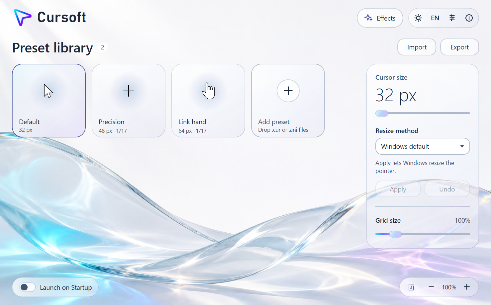
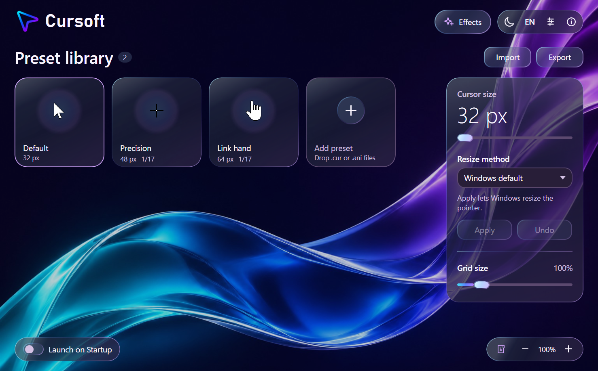

# Cursoft

Cursoft is a portable cursor manager for Windows x64. Save cursor presets, change your pointer size, and add effects that follow the mouse across your desktop.

| Day                                                                                 | Night                                                                            |
|:-----------------------------------------------------------------------------------:|:--------------------------------------------------------------------------------:|
|  |  |

## Presets

Drop `.cur` or animated `.ani` files into the library to create a preset. Assign the files to cursor roles, save, and click the preset card to use it. **Export** saves presets as a `.cursoft` bundle you can bring back with **Import**.

To resize the pointer, choose a size and click **Apply**. Leave **Resize method** on **Windows default**, or choose **Smooth edges** for curves and **Crisp pixels** for pixel art.

## Cursor effects

Open **Effects** and move the pointer inside the preview to try a style. Each effect remembers its own colors, opacity, and other settings. Click **Apply** to turn it on, or choose **Off** and apply to turn it off. [View the effects editor](docs/screenshots/ribbon-trail.webp).

| Effect                                                                                                                                                                           | Motion preview                                                                                                    |
| -------------------------------------------------------------------------------------------------------------------------------------------------------------------------------- |:-----------------------------------------------------------------------------------------------------------------:|
| **Glow** keeps the pointer easy to spot, even at rest. Choose a soft halo, ring, or crosshair. Adjust the radius for a tight highlight around the tip or a wider glow.           |      |
| **Ribbon Trail** draws thin strands that fan out around turns and settle when you stop. Adjust the trail length for longer arcs and the line width for a finer or bolder stroke. |     |
| **Sparks** scatters fading particles along the pointer’s path. Increase spread for a wider scatter, trail length for a longer wake, or particle size for larger sparks.          |  |

Ribbon Trail and Sparks each have a **Cycle colors** option for a gradual hue shift. Turn it off to use your saved primary and accent colors.

## Tray and startup

When closing Cursoft, choose **Minimize to tray** to keep effects running or **Exit** to quit. **Remember my choice** saves your preference. You can change it later from **Close behavior** in the toolbar. [View the close dialog](docs/screenshots/close-dialog.webp).

Double-click the tray icon to reopen Cursoft, or right-click it and choose **Exit** to quit. Enable **Launch on Startup** to restore your selected effect in the background when you sign in to Windows.

## Build and Download

[Download Cursoft.exe from the latest GitHub release](https://github.com/4xura/Cursoft/releases/latest).

Open `Cursoft.sln` in **Microsoft Visual Studio** with the **.NET desktop development** workload installed. On first open, let NuGet restore the project’s packages. Choose **Build → Build Solution** (`Ctrl+Shift+B`).

The solution defaults to **Release | x64** and writes `release\Cursoft.exe`. Copy that single file to another Windows x64 PC to run it. The .NET runtime is included.

In **Developer PowerShell for Visual Studio**, this command restores packages and builds the solution from the project root.

```powershell
MSBuild.exe .\Cursoft.sln /restore
```
