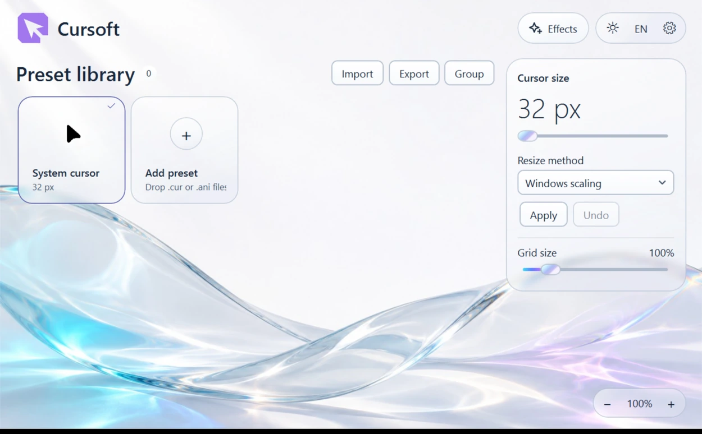
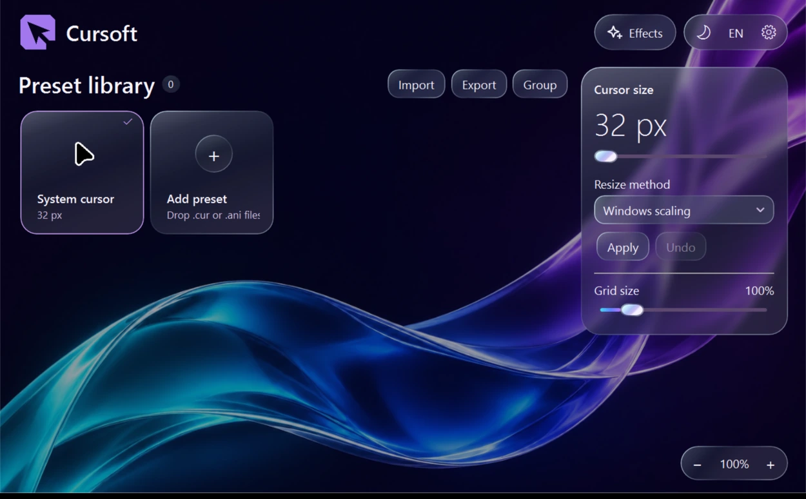
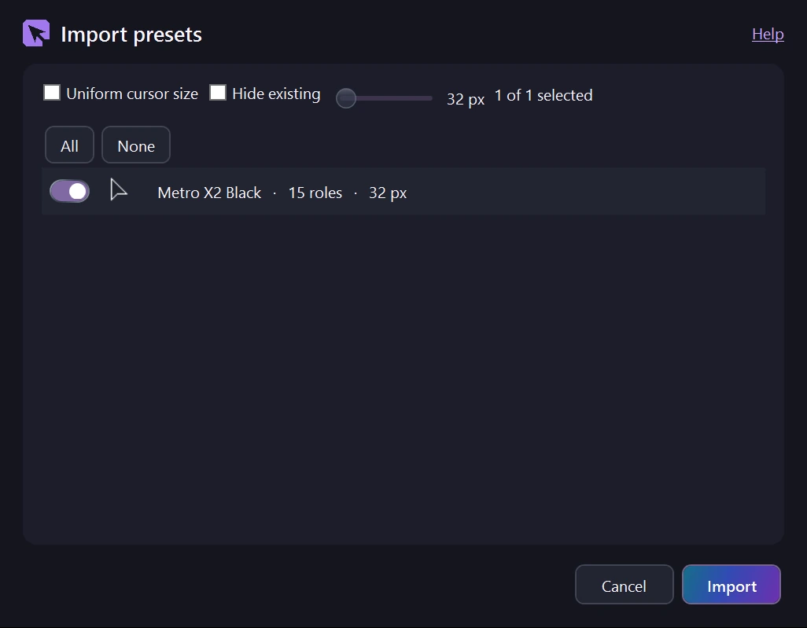
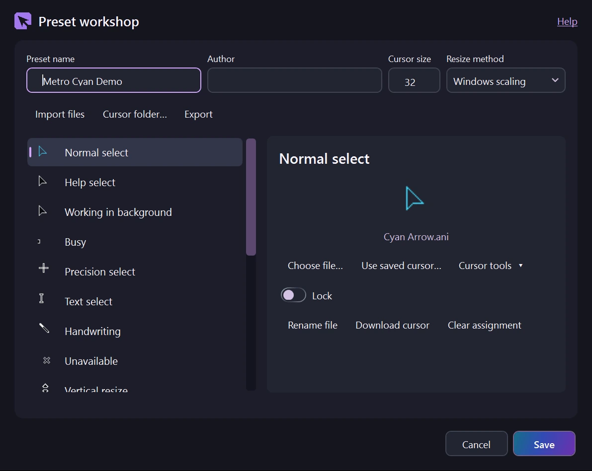
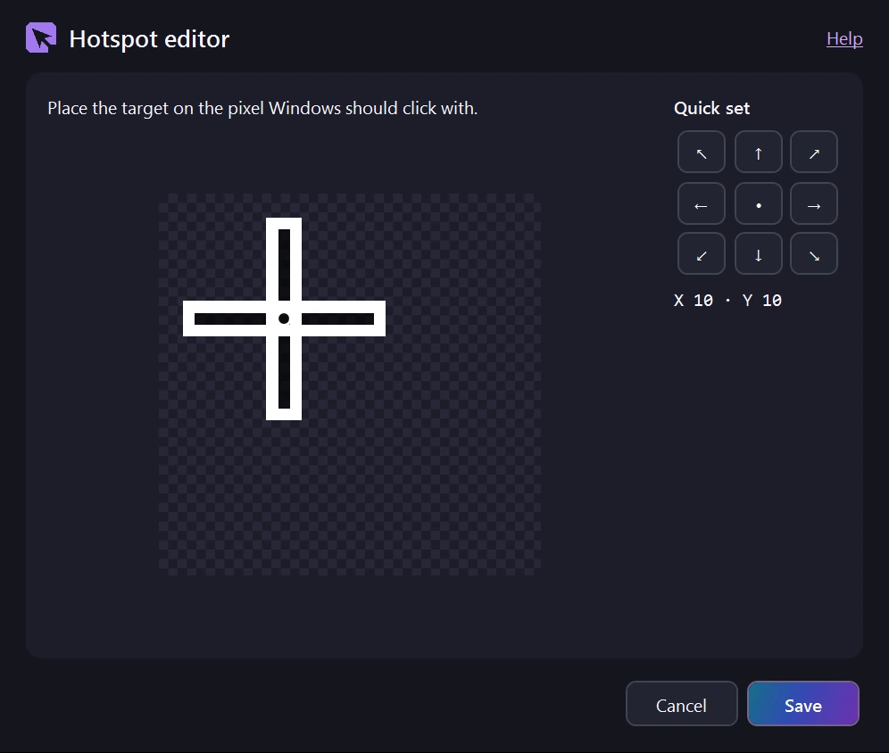
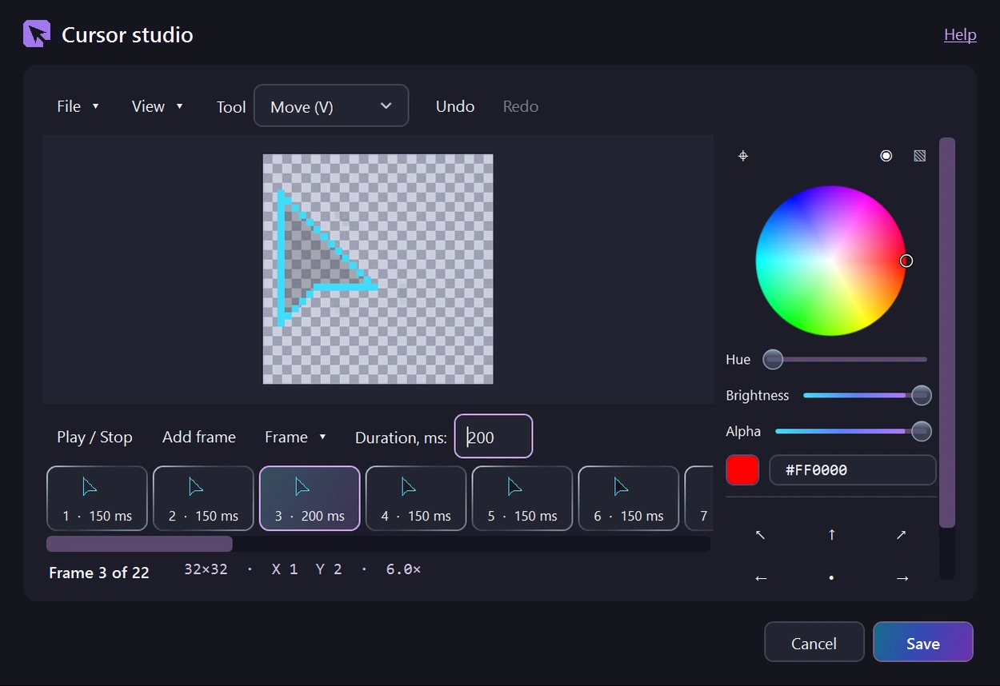
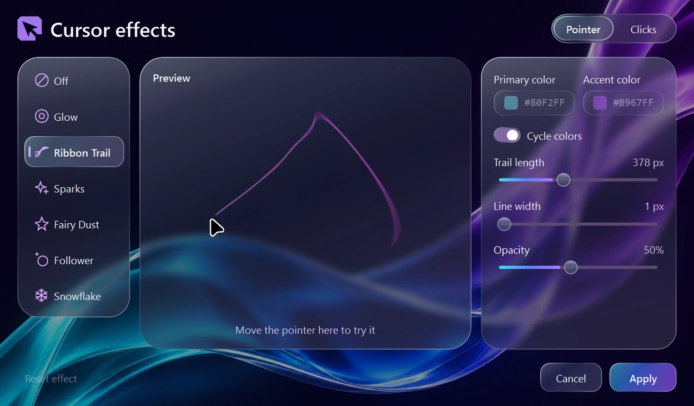
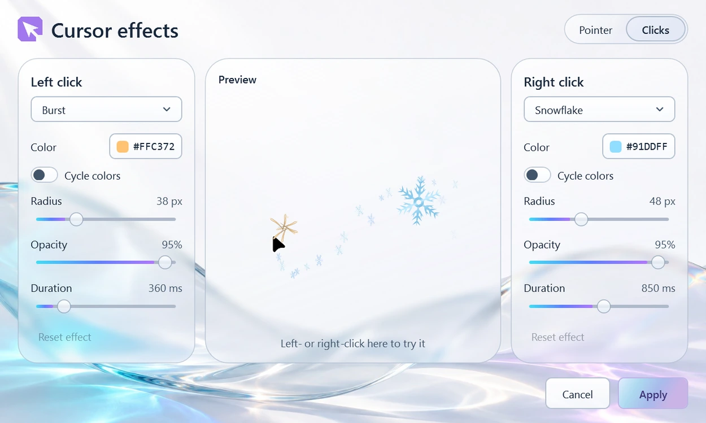
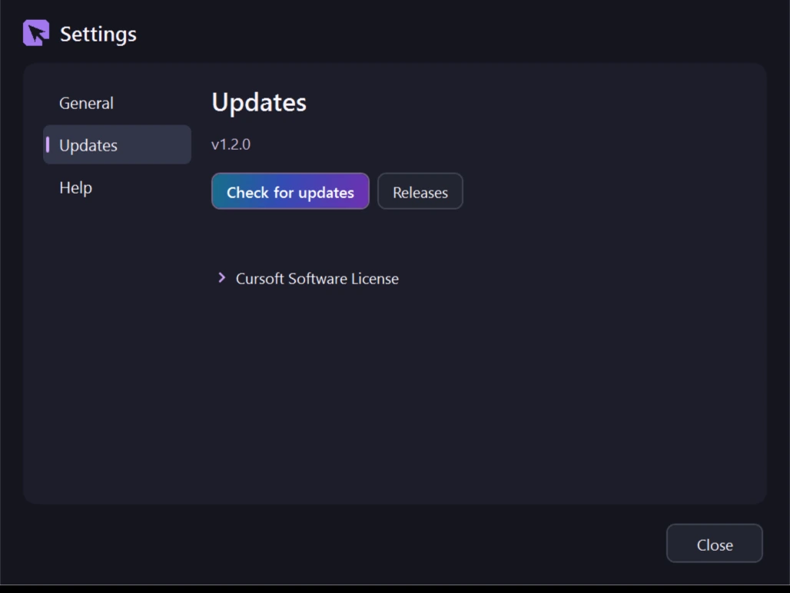

# Cursoft

Cursoft is a portable cursor manager for Windows x64. Save cursor presets, change your pointer size, and add effects that follow the mouse across your desktop.

[Download Cursoft.exe](https://github.com/4xura/Cursoft/releases/latest)

| Day                                                                                 | Night                                                                            |
|:-----------------------------------------------------------------------------------:|:--------------------------------------------------------------------------------:|
|  |  |

## Import a cursor pack

A preset saves a set of cursor files, their Windows roles, and a pointer size.

1. Choose **Import** → **Cursor folder…**, open `<cursor pack folder>`, and click **Select Folder**.
2. Select `<preset name>` and click **Import**. If the pack includes `Install.inf`, Cursoft uses it to map the cursor roles.
3. Click the new card when you want to apply the scheme. Importing alone leaves the current pointer active.

You can also drag the folder into the library or import loose `.cur` and `.ani` files. Use **Export** to save a `.cursoft` bundle or create an Xcursor theme for Linux. To resize a pointer, choose a size and click **Apply**. **Windows scaling** keeps the selected cursor files.

## Edit a cursor

Right-click a preset card and choose **Edit preset**. Select a role in the workshop and open **Cursor tools**. The examples below use **Metro Cyan Demo**, a copy of Metro X2 Black with a recolored arrow.

### Set the click point

For Metro’s crosshair, select **Precision select** → **Cursor tools** → **Hotspot**. Place the marker at the intersection. This is the pixel Windows uses for clicks.

### Edit artwork and animation

Choose **Normal select** → **Cursor tools** → **Edit cursor image…**. Use **Brush**, **Eraser**, or **Fill** to edit pixels, and **Move** to shift the artwork.

To slow one step in the demo’s animation, select frame 3, enter **200** in **Duration, ms**, and press **Enter**. Use **Play / Stop** to preview the change. **Add frame** duplicates the selected frame, and the **Frame** menu lets you reorder or remove it.

| Tool | Use |
| --- | --- |
| **Canvas** | Resize the canvas and choose where to anchor the artwork. |
| **Background Ref** | Trace over a reference image that stays out of the saved cursor. |
| **Icon Sizes** | Include more than one resolution so Windows can choose a size for the display. |
| **File** | Load an image or export a PNG or animated GIF preview. |

Click **Save** in the editor, then **Save** in the workshop. Edit pointer trails and click animations in **Effects**.

## Cursor effects

Cursoft uses the cursor you chose in Windows for desktop effects. The **System cursor** card shows that selection, and effects work without a Cursoft preset.

Open **Effects**. On **Pointer**, choose the style that follows movement. On **Clicks**, assign a separate effect to the left and right buttons.

Move and click inside the shared preview to try the combination. Each button remembers the color, radius, opacity, duration, and **Cycle colors** setting for each click style. Choose **Off** to mute a button. **Apply** saves all three choices.

| Pointer | Clicks |
|:---:|:---:|
|  |  |

### Pointer effects

| Effect                                                                                                                                                                           | Motion preview                                                                                                    |
| -------------------------------------------------------------------------------------------------------------------------------------------------------------------------------- |:-----------------------------------------------------------------------------------------------------------------:|
| **Glow** keeps the pointer easy to spot, even at rest. Choose a soft halo, ring, or crosshair. Adjust the radius for a tight highlight around the tip or a wider glow.           |      |
| **Ribbon Trail** draws thin strands that fan out around turns and settle when you stop. Adjust the trail length for longer arcs and the line width for a finer or bolder stroke. |     |
| **Sparks** scatters fading particles along the pointer’s path. Increase spread for a wider scatter, trail length for a longer wake, or particle size for larger sparks.          |  |
| **Fairy Dust** leaves faceted stars that lift, catch the light, and drift down as they fade. Adjust the emission rate, particle size, and lifetime. |  |
| **Follower** moves a dot and a slower ring toward the pointer. Adjust the follow lag, ring radius, and dot size. |  |
| **Snowflake** leaves six-armed crystals that sway and tilt as they fall. Adjust the emission rate, flake size, and lifetime. |  |

Ribbon Trail, Sparks, Fairy Dust, Follower, and Snowflake each have a **Cycle colors** option for a gradual hue shift. Turn it off to use your saved primary and accent colors.

### Click effects

Each click animation stays at the press location. **Ripple** sends a thin crest across the click point, followed by a softer echo. **Burst** throws tapered sparks that break into embers. **Pulse** gathers light at the tip and releases a soft wave.

| Ripple | Burst | Pulse |
|:---:|:---:|:---:|
|  |  |  |

**Fairy Dust** tosses stars along different arcs. Each catches the light before falling away. **Follower** sends a dot around the press, with a ring catching up as the dot settles. **Snowflake** grows from a hexagonal seed, then sheds small crystals from its branches.

| Fairy Dust | Follower | Snowflake |
|:---:|:---:|:---:|
|  |  |  |

## Download and update

Download **Cursoft.exe** from the [latest GitHub release](https://github.com/4xura/Cursoft/releases/latest) and run it from a folder you can write to. The standalone executable includes the .NET runtime. Cursoft stores your settings and presets in `%LOCALAPPDATA%\Cursoft`.

Open **Settings** → **Updates** and choose **Check for updates**. When a newer public release is available, **Install update** verifies the download and restarts Cursoft with your settings and presets.

## License

Builds distributed under the Cursoft Software License are free for personal, noncommercial use. Business or commercial use requires a separate written license. [Cursoft Software License](LICENSE)
